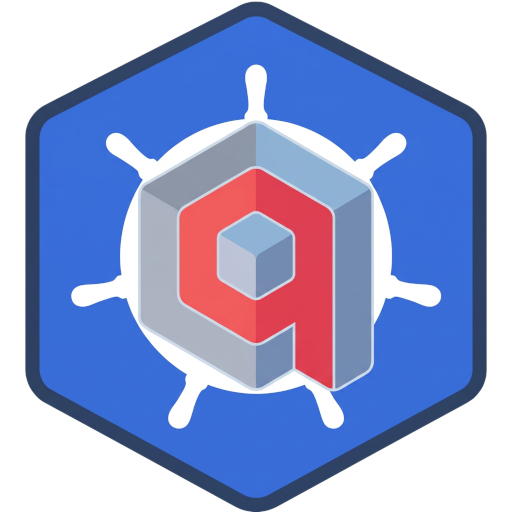

<p style="text-align:center;" align="center">
  </a>  
</p>

<h4 align="center">Kubernetes operator for the <a href="https://github.com/qdrant/qdrant" target="_blank">Qdrant</a> Vector Database.</h4>

<p align="center">
  <a href="#-key-features">Key Features</a> •
  <a href="#-installation">Installation</a> •
  <a href="#-quickstart">Quickstart</a> •
  <a href="#-security">Security</a> •
  <a href="#-backups">Backups</a> •
  <a href="#-documentation">Documentation</a> •
  <a href="#-demo-application">Demo application</a>
</p>


## 🎯 Key features

The operator provides the following functionality:

- Creation of single-node and multi-node Qdrant clusters (tested up to Qdrant `v1.20.2`), cluster scaling.
- Authentication support using API keys (read-write and read-only, auto-generated or user-provided) and **JWT RBAC** (`spec.jwtRbac`).
- TLS Encryption support for client and peer-to-peer connections with per-cluster CA verification (auto-generated or user-provided certificates).
- Production-ready pod configuration: HTTP/HTTPS probes (`/readyz`, `/livez`, `startupProbe`), `podSecurityContext`/`securityContext`, `nodeSelector`, `env`/`envFrom`, `podAnnotations`/`podLabels`, tolerations, affinities, and topology spread.
- Support for setting custom Qdrant parameters (`spec.config`, e.g. `io_uring: auto`, quotas, audit logs, or Qdrant's built-in S3 snapshot storage via `spec.config` + `spec.envFrom`).
- Management of Qdrant collections with status reporting, supporting custom `distance`/`datatype`, named & multi-vectors, sparse vectors, payload indexes (including full-text BM25 and nested fields), replication, sharding, indexing, and quantization.
- High-availability operator mode with native Kubernetes Lease leader election and `/healthz` + `/readyz` probes.
- Instant and scheduled collection snapshots stored in any S3-compatible storage.

### 🔨 Installation

To run the operator you need Kubernetes version 1.26+.

The operator includes two custom resources - `QdrantCluster` and `QdrantCollection`. Install the CRDs by running the commands below:

```bash
kubectl apply -f https://raw.githubusercontent.com/ganochenkodg/qdrant-operator/main/deploy/crds/crd-qdrantcluster.yaml
kubectl apply -f https://raw.githubusercontent.com/ganochenkodg/qdrant-operator/main/deploy/crds/crd-qdrantcollection.yaml
```

You will see the next output:

```console
customresourcedefinition.apiextensions.k8s.io/qdrantclusters.qdrant.operator created
customresourcedefinition.apiextensions.k8s.io/qdrantcollections.qdrant.operator created
```

Install the operator by running the command below:

```bash
kubectl apply -f https://raw.githubusercontent.com/ganochenkodg/qdrant-operator/main/deploy/operator.yaml
```

```console
namespace/qdrant-operator created
serviceaccount/qdrant-operator-sa created
clusterrole.rbac.authorization.k8s.io/qdrant-operator-role created
clusterrolebinding.rbac.authorization.k8s.io/qdrant-operator-rolebinding created
configmap/qdrant-operator-config created
deployment.apps/qdrant-operator created
```

Wait for operator's readiness:

```bash
kubectl wait pods -l app=qdrant-operator --for condition=Ready --timeout=300s -n qdrant-operator
```

And check operator's logs to ensure it is working:

```bash
kubectl logs deploy/qdrant-operator -n qdrant-operator
```

```console
Found 3 pods, using pod/qdrant-operator-d8bccb5d5-qgfqc
2026-11-24T00:10:54.171Z: Debug mode enabled.
2026-11-24T00:10:54.185Z: Pod "qdrant-operator-d8bccb5d5-qgfqc" is FOLLOWER. Acquiring leader status...
2026-11-24T00:10:54.226Z: Health server listening on :8080
2026-11-24T00:11:04.386Z: Pod "qdrant-operator-d8bccb5d5-qgfqc" is LEADER.
2026-11-24T00:11:04.388Z: Watching QdrantClusters API.
2026-11-24T00:11:04.390Z: Watching QdrantCollections API.
```

### ⚡ Quickstart

Deploy your first Qdrant cluster by applying the minimal QdrantCluster custom resource:

```bash
cat <<EOF | kubectl apply -f -
apiVersion: qdrant.operator/v1alpha1
kind: QdrantCluster
metadata:
  name: my-cluster
spec:
  replicas: 1
  image: qdrant/qdrant:v1.20.2
EOF
```

```console
qdrantcluster.qdrant.operator/my-cluster created
```

Check operator's logs to ensure cluster is running now:

```console
2026-11-24T00:11:04.415Z: Received ADDED event for cluster "default/my-cluster".
2026-11-24T00:11:05.474Z: Cluster "my-cluster" status is now Pending.
2026-11-24T00:11:05.518Z: ConfigMap "my-cluster" not found. Creating...
2026-11-24T00:11:05.545Z: ConfigMap "my-cluster" created successfully.
2026-11-24T00:11:05.567Z: Service "my-cluster-headless" not found. Creating...
2026-11-24T00:11:05.594Z: Service "my-cluster-headless" created successfully.
2026-11-24T00:11:05.615Z: Service "my-cluster" not found. Creating...
2026-11-24T00:11:05.645Z: Service "my-cluster" created successfully.
2026-11-24T00:11:05.699Z: StatefulSet "my-cluster" not found. Creating...
2026-11-24T00:11:05.736Z: StatefulSet "my-cluster" created successfully.
2026-11-24T00:11:10.755Z: Cluster "my-cluster" is not ready: 0/1 replicas available.
2026-11-24T00:11:15.752Z: Cluster "my-cluster" is not ready: 0/1 replicas available.
2026-11-24T00:11:20.754Z: Cluster "my-cluster" is ready.
2026-11-24T00:11:20.790Z: Cluster "my-cluster" status is now Running.
```

There are two mandatory parameters - `replicas` and `image`. You can check minimal and complete YAML manifests in the [examples](examples) folder.

By default there are no replication, resources, data persistence and scheduling options configured.

Now create your first vector [collection](https://qdrant.tech/documentation/concepts/collections/):

```bash
cat <<EOF | kubectl apply -f -
apiVersion: qdrant.operator/v1alpha1
kind: QdrantCollection
metadata:
  name: my-collection
spec:
  cluster: my-cluster
  vectorSize: 10
EOF
```

```console
qdrantcollection.qdrant.operator/my-collection created
```

Check logs:

```console
2026-11-24T00:12:43.102Z: Received ADDED event for collection "default/my-collection".
2026-11-24T00:12:43.148Z: Creating collection "my-collection" in cluster "my-cluster"...
2026-11-24T00:12:43.459Z: Qdrant response: status="ok", time=0.311443s.
```

There are two mandatory parameters - `cluster` with the cluster reference and `vectorSize`. Minimal and complete manifests are also stored in the [examples](examples) folder.

By default disk storage is not configured and will use global cluster parameters, and shards number and replication factor are configured to `1` both.

### 🔒 Security

You can enable traffic encryption for client connections and between Qdrant nodes using the `spec.tls.enabled` option. 
You can provide your own certificates (`spec.tls.secretName`) or use those generated by the operator.

```yaml
apiVersion: qdrant.operator/v1alpha1
kind: QdrantCluster
...
spec:
  ...
  tls:
    enabled: true
    # secretName: your-certs-secret
```

Authentication is supported using API keys and read-only API keys. The parameters can be 'false', 'true' (operator generates keys), or 'your-own-custom-key'.

```yaml
apiVersion: qdrant.operator/v1alpha1
kind: QdrantCluster
...
spec:
  apikey: 'true'
  readApikey: 'readoperationskey123'
```

### 💾 Backups

The operator allows you to create instant and scheduled snapshots of collections, storing data in S3 buckets (various cloud providers are supported). 
Use the `spec.snapshots` option.

```yaml
apiVersion: qdrant.operator/v1alpha1
kind: QdrantCollection
...
spec:
  ...
  snapshots:
    s3EndpointURL: https://storage.googleapis.com/
    # s3EndpointURL: https://s3.amazonaws.com
    s3CredentialsSecretName: your-credentials-secret
    bucketName: your-bucket-for-snapshots
    # backupNow: true
    backupSchedule: "0 0 * * *"
    # restoreSnapshotName: clustername/collectionname/2024-01-01-23-59
```

Ensure to replace placeholders `your-credentials-secret` and `your-bucket-for-snapshots` with your actual secret name and bucket name.

Alternatively, Qdrant natively supports storing snapshots directly in S3 (or GCS/Azure) without operator backup jobs — configure `spec.config.storage.snapshots_config` and pass credentials via `spec.envFrom` on `QdrantCluster`. See the [Backup and Restore guide](docs/backup-restore.md#native-qdrant-s3-snapshot-storage) and the [official Qdrant Snapshots documentation](https://qdrant.tech/documentation/concepts/snapshots/).

### 🤖 Demo application


Check the [demo-app](demo-app/README.md) folder to see a simple demo application that allows you to upload PDF documents to Qdrant and answer questions about the contents of the file. 
The demo application does not rely on paid APIs from well-known services (such as Google Vertex AI or OpenAI). 

### 📖 Documentation

Guides:

- [TLS usage](docs/tls.md)
- [Authentication](docs/authentication.md)
- [Cluster architecture](docs/architecture.md)
- [QdrantClusters API reference](docs/qdrantclusters-api.md)
- [QdrantCollections API reference](docs/qdrantcollections-api.md)
- [Backup and Restore](docs/backup-restore.md)

YAML examples:

- [Minimal Qdrant cluster](examples/qdrant-cluster-minimal.yaml)
- [Qdrant cluster with authentication](examples/qdrant-cluster-apikey.yaml)
- [Qdrant cluster with TLS](examples/qdrant-cluster-tls.yaml)
- [Complete Qdrant cluster](examples/qdrant-cluster-complete.yaml)
- [Minimal Qdrant collection](examples/qdrant-collection-minimal.yaml)
- [Qdrant collection with replication](examples/qdrant-collection-replication.yaml)
- [Qdrant collection with snapshots](examples/qdrant-collection-snapshot.yaml)
- [Complete Qdrant collection](examples/qdrant-collection-complete.yaml)

### ⭐ Give a Star! 

Do you like this project? Support it by **giving a star**!

### ❓ Help and contribution.

If you encounter any issues while using Qdrant-operator, you can get help using [Github issues](https://github.com/ganochenkodg/qdrant-operator/issues). 
If you want to help out with a code contribution, check the [Contribution guideline](./CONTRIBUTING.md).

## License

This project is licensed under the [MIT](./LICENSE) license.

## Disclaimer of Warranty

Please note that the Qdrant operator currently is under development and new releases might contain bugs and breaking changes. The operator is not affiliated with [Qdrant](https://github.com/qdrant/).
