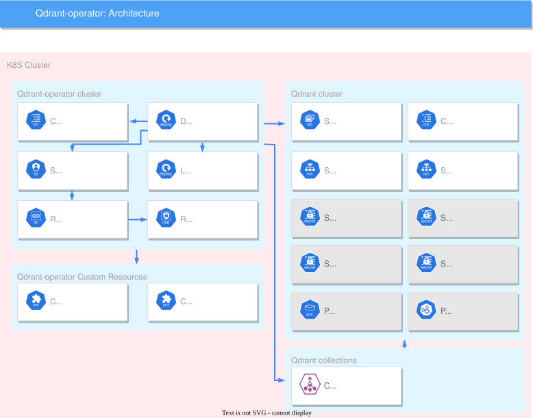

# Architecture

The Qdrant operator consists of the following components:

- Operator `Deployment` with 3 replicas (leader election via Kubernetes `Lease`, HTTP `/healthz` and `/readyz` probes on port `8080`, and Kubernetes Informers for `QdrantCluster` and `QdrantCollection` CRDs).
- `ConfigMap` (`qdrant-operator-config`) with operator parameters.
- `ClusterRole` => `ClusterRoleBinding` => `ServiceAccount` (`qdrant-operator-sa`) with the required permissions.

The required Kubernetes version is 1.26 or higher.

For each `QdrantCluster`, the operator manages the following resources:

- `StatefulSet` (`<cluster>`) with Qdrant database replicas (with HTTP/HTTPS `/readyz` and optional `/livez` / `startupProbe` probes).
- `ConfigMap` (`<cluster>`) with cluster bootstrap script (`initialize.sh`) and custom Qdrant configuration (`production.yaml`).
- Two `Service` resources: `<cluster>` (for client connections) and `<cluster>-headless` (for peer-to-peer Raft communication).
- Optional `Secret` resources: `<cluster>-apikey`, `<cluster>-read-apikey`, and `<cluster>-auth-config` (`local.yaml`, supporting API keys and JWT RBAC) when authentication is enabled.
- Optional `Secret` (`<cluster>-server-cert`) when TLS encryption is enabled and certificates are generated by the operator.
- Optional `PodDisruptionBudget` (`<cluster>`) when `spec.replicas > 1` (automatically deleted if scaled down to 1 replica).

For each `QdrantCollection`, the operator manages collection lifecycle (creation, updates, payload indexes, deletion, and `.status` reporting) over HTTP or CA-verified HTTPS using the cluster's API key when enabled, and optionally creates backup/restore `Job` and `CronJob` resources when `spec.snapshots` is configured.
